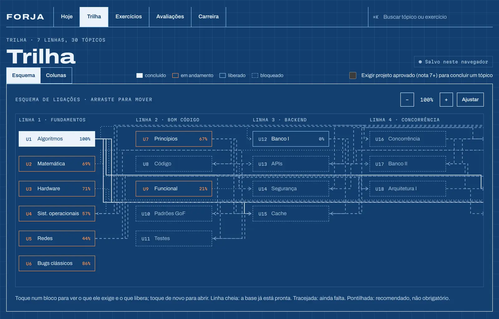
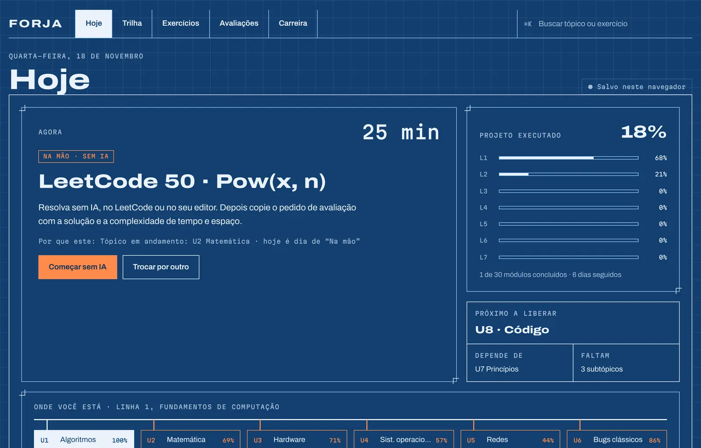
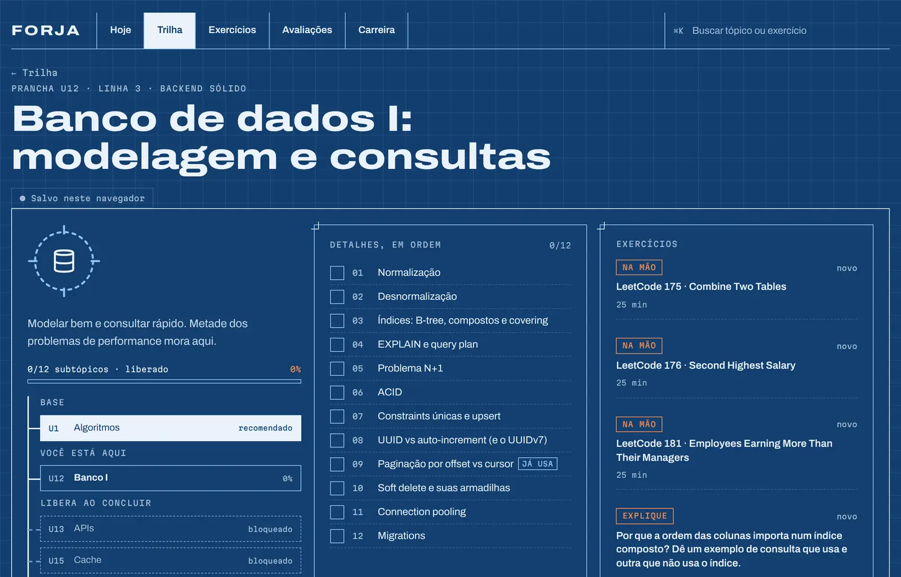

<div align="center">

# FORJA

**Trilha de estudos de engenharia de software, do algoritmo ao system design.**
30 tópicos ligados por dependência, exercícios com nota e um plano de cursos e pós.

[](https://github.com/carlosna7/forja/actions/workflows/ci.yml)


**[Abrir a Forja →](https://forja-nine-sigma.vercel.app)**



</div>

## O que é

A Forja organiza o que estudar depois da graduação em ADS para chegar a engenheiro de software e de IA. Cada tópico é um bloco numa planta: ele só libera quando a base que ele exige está pronta.

- **Hoje**: um exercício recomendado para agora, o progresso de cada linha da trilha e o próximo tópico a liberar.
- **Trilha**: as 7 linhas e os 30 tópicos em esquema de ligações (com zoom e arraste) ou em colunas.
- **Prancha do tópico**: por que estudar, checklist de subtópicos, exercícios e materiais.
- **Exercícios**: LeetCode feito à mão, "Explique", "Revise a IA" e projetos, com nota de 0 a 10.
- **Avaliações**: histórico de notas, média geral e por modo.
- **Carreira**: cronograma editável de cursos, comparativo de pós (EAD ou híbrido à noite em SP) e a linha paralela de soft skills e certificações.

<table>
  <tr>
    <td></td>
    <td></td>
  </tr>
</table>

## Como usar

1. Abra [forja-nine-sigma.vercel.app](https://forja-nine-sigma.vercel.app) e vá em **Hoje**. O exercício do topo já é o mais indicado para o momento.
2. Estude o tópico e marque os subtópicos na **prancha**. Quando todos estiverem marcados, o tópico conclui e libera os seguintes.
3. Faça o exercício, clique em **Copiar pedido de avaliação** e cole numa conversa com o Claude.
4. Registre a nota que ele der. Nota 7 ou mais conta como aprovado.
5. De vez em quando, use **Exportar progresso** no rodapé para guardar um backup.

O guia completo, tela por tela, está em [docs/uso.md](docs/uso.md).

> Seu progresso fica no `localStorage` do navegador. Nada é enviado para servidor nenhum. Para levar para outro computador, exporte e importe o arquivo JSON.

## Rodando localmente

Requer Node 22.12 ou mais novo.

```bash
git clone https://github.com/carlosna7/forja.git
cd forja
npm ci
npm run dev        # http://localhost:5173
```

| Script | O que faz |
| --- | --- |
| `npm run dev` | Servidor de desenvolvimento com recarga instantânea |
| `npm run typecheck` | Checa os tipos do app e dos testes |
| `npm test` | Roda os testes com o runner nativo do Node |
| `npm run build` | Checa os tipos e gera o site estático em `dist/` |
| `npm run preview` | Serve o `dist/` para conferir o build |
| `npm run check` | Tudo acima em sequência, como no CI |

## Estrutura

```
src/
├── data/          conteúdo da trilha (content.json) e tipos
├── domain/        regras puras: progresso, bloqueio, recomendação, layout do grafo
├── state/         estado salvo no navegador, com validação
├── lib/           rotas por hash, formatação, área de transferência
├── components/    cabeçalho, blocos, checklist, rodapé de dados
├── views/         uma tela por arquivo
└── styles/        design system "cianótipo" em CSS puro
tests/             testes de validação e das regras de progresso
docs/              arquitetura, uso, conteúdo, segurança e deploy
```

## Documentação

| Documento | Para quê |
| --- | --- |
| [Arquitetura](docs/arquitetura.md) | Como o app é montado, fluxo de dados e decisões técnicas |
| [Guia de uso](docs/uso.md) | Cada tela e o ciclo de estudo |
| [Conteúdo](docs/conteudo.md) | Como adicionar tópicos, exercícios e ligações |
| [Segurança](docs/seguranca.md) | Cabeçalhos, CSP, validação de dados e dependências |
| [Deploy](docs/deploy.md) | Publicar na Vercel e conferir os cabeçalhos |

## Segurança em uma linha

Site estático, sem backend e sem cookies, servido com CSP restrita (`script-src 'self'`, sem inline), HSTS, proteção contra iframe e fontes hospedadas no próprio domínio. Tudo que vem do navegador ou de um arquivo importado é validado antes de entrar no app. Detalhes em [docs/seguranca.md](docs/seguranca.md) e como reportar falhas em [SECURITY.md](SECURITY.md).
