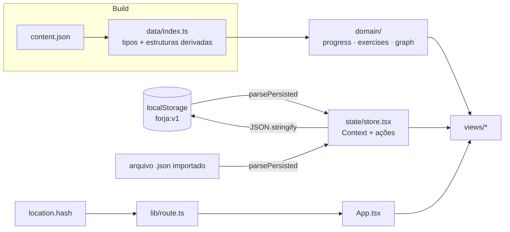

# Arquitetura

A Forja é uma SPA estática em React 19 + TypeScript, empacotada pelo Vite 8. Não existe backend: o conteúdo vai junto no bundle e o progresso fica no navegador.

## Visão geral



## Camadas

| Pasta | Responsabilidade | Depende de |
| --- | --- | --- |
| `src/data` | Conteúdo tipado: linhas, tópicos, ligações, cursos. Gera os ids dos subtópicos e as listas de dependência. | nada |
| `src/domain` | Funções puras que recebem o estado salvo e devolvem números: status de cada tópico, recomendação, layout do grafo, textos para colar no Claude. | `data` |
| `src/state` | Formato salvo, valores padrão, validação (`persist.ts`) e o `StoreProvider` com as ações. | `data` |
| `src/lib` | Utilidades sem regra de negócio: rotas, formatação, área de transferência e download. | `data` (só para validar rotas) |
| `src/components` | Peças visuais reaproveitadas. | todas acima |
| `src/views` | Uma tela por arquivo. | todas acima |

As regras de negócio não conhecem React. Isso deixa `domain` e `state/persist.ts` testáveis com o runner nativo do Node (`tests/`).

## Estado

Um único objeto `Persisted`, salvo na chave `forja:v1`:

```ts
{
  v: 1,
  done: { 'm12.3': true },          // subtópicos marcados
  days: { '2026-11-18': true },     // dias com atividade (sequência de dias)
  plan: [{ id, s, e, done }],       // cronograma de cursos (meses 0..12)
  requireProject: false,            // exigir projeto 7+ para concluir
  grades: [{ id, exId, n, mode, title, nota, notes, createdAt }],
  ui: { trilha, z, exMode, exLocked }
}
```

- Todo `setState` gera um objeto novo; um `useEffect` grava no `localStorage`.
- O evento `storage` mantém duas abas abertas em sincronia.
- A leitura sempre passa por `parsePersisted`, que descarta o que não reconhece. Ver [seguranca.md](seguranca.md#validação-de-dados).
- O campo `v` permite migrar o formato no futuro sem quebrar o progresso salvo.
- Rascunhos de resposta ficam só na memória da aba, de propósito: podem conter código do trabalho.

## Regras de progresso

```
concluído(n) = todos os subtópicos de n marcados
               E (se requireProject) existe nota de Projeto ≥ 7 em n
liberado(n)  = todas as dependências obrigatórias de n concluídas
status(n)    = bloqueado | liberado | em andamento | concluído
```

Dependências "recomendadas" (`[a, b, 1]` em `EDGES`) aparecem na tela mas não bloqueiam.

## Recomendação

`recommend()` pontua cada exercício dos tópicos liberados:

| Critério | Pontos |
| --- | --- |
| Tópico em andamento / liberado / concluído | 30 / 18 / 10 |
| Posição na trilha | −0,3 por tópico |
| Modo do dia (dom: Explique, seg: Na mão, ter: Revise a IA, ...) | +8 |
| Modo "Na mão" (mantém a lógica ativa sem IA) | +3 |
| Tópico parado há 7 dias ou mais | +5 |
| Já tentou e não passou | +2 |

Exercícios aprovados saem da lista. Projetos só aparecem depois de começar o tópico.

## Esquema de ligações

`domain/graph.ts` posiciona cada tópico numa grade (coluna = linha da trilha, fileira = ordem). As ligações são caminhos SVG em ângulo reto:

1. saem pela direita do bloco de origem;
2. descem ou sobem no vão depois da coluna, cada uma numa faixa própria (`14 + k·7 px`) para não se sobrepor;
3. quando pulam colunas, andam por um corredor entre fileiras e entram pela esquerda do destino.

Assim nenhuma linha atravessa um bloco. O caminho é calculado uma vez, no carregamento; o estilo (cheia, tracejada, pontilhada, destacada) muda conforme o progresso e a seleção.

## Rotas

Rotas por hash (`#hoje`, `#t-12`, `#x-lc-4-1`) para funcionar em qualquer hospedagem estática, sem reescrita de URL no servidor. `parseHash` só aceita formatos conhecidos; qualquer outra coisa cai em `#hoje`.

## Estilo

CSS puro em `src/styles/global.css`, sem framework. Tokens em `:root` (papel azul `--paper`, tinta `--ink`, ciano `--cyan`, lápis laranja `--pencil`). Tipografia: Archivo com eixo de largura para títulos e corpo, Martian Mono para rótulos técnicos, ambas hospedadas no próprio site via Fontsource.

## Decisões

| Decisão | Por quê | Custo |
| --- | --- | --- |
| Sem backend | Zero custo, zero superfície de ataque no servidor, funciona offline depois de carregar. | Sem sincronização entre aparelhos (resolvido com exportar/importar). |
| Avaliação copiando um pedido para o Claude | Não expõe chave de API no front-end. | Um passo manual a mais. |
| Rotas por hash | Deploy estático sem configuração. | URLs com `#`. |
| Fontes no próprio domínio | Permite `font-src 'self'` e evita rastreamento por CDN de fontes. | ~300 KB de fontes no build (cache imutável). |
| Conteúdo em JSON | Editar a trilha não exige mexer em componente. | Ids de subtópico são posicionais (ver [conteudo.md](conteudo.md)). |
| Testes com `node --test` | Nenhuma dependência extra para testar regras puras. | Sem testes de componente por enquanto. |
